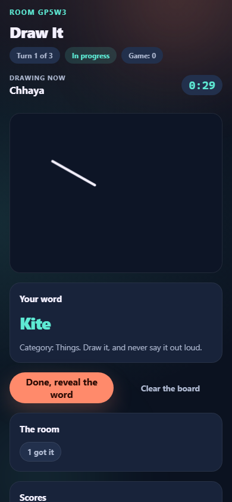
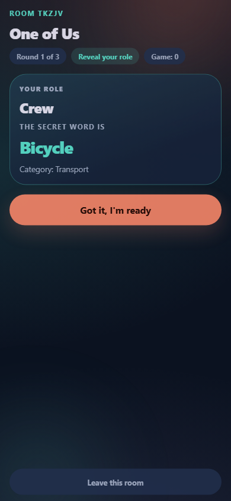
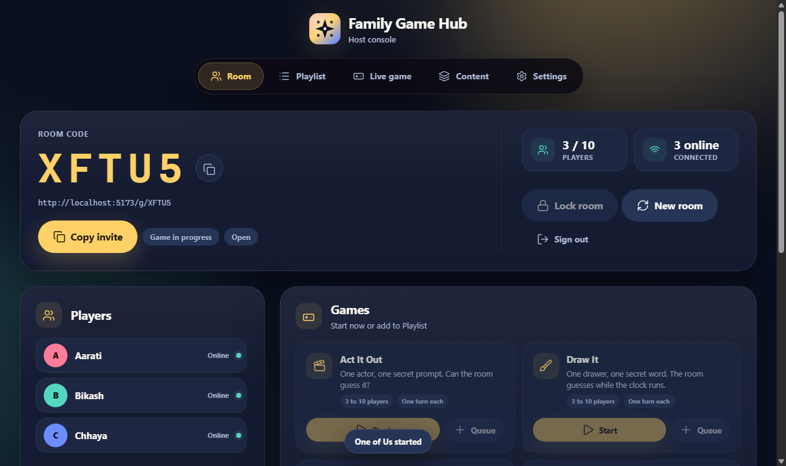
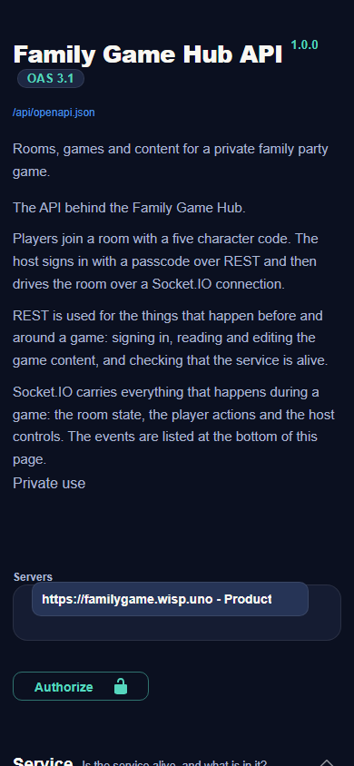

# Family Game Hub



Made by **VoidX3D (Sincere Bhattarai)**.

A private, browser-based party-game hub for 3 to 10 players in the same room.
One host opens a room, everyone joins from a phone or laptop with a five-character
code, and the host starts a game. The server owns every room, turn, score, and
secret assignment.

No database is required. Rooms live in server memory. The built-in question bank
is in `server/data/default-content.json`; edits made in the host console are
saved to `server/data/content.json`.

## What it looks like

| One of Us | Draw It |
| --- | --- |
|  |  |

| The host console | The API documentation |
| --- | --- |
|  |  |

More in [`preview/`](preview/).

## Games in v1

| Game | Players | Rounds | How points work |
| --- | --- | --- | --- |
| One of Us | 3 to 10 | 3 | Crew win: 1 each. Imposter win: 2. |
| Who Am I? | 3 to 10 | 3 | Exact person guess: 1. |
| Where Am I? | 3 to 10 | 3 | Exact place guess: 1. |
| Who Is It? | 3 to 10 | 3 | Most-voted player(s): 1 each. |
| Who Wrote That?! | 3 to 10 | 3 | Each correct author match: 1. |
| Act It Out | 3 to 10 | One turn each | Actor and correct guesser: 1 each. |
| Truth or Dare | 3 to 10 | 2 cycles | Just for fun; no points. |
| Draw It | 3 to 10 | 1 turn each | Each correct guess: 1. The drawer: 1. |

Nothing is timed, with one deliberate exception: **Draw It** runs on a clock,
because a drawing turn that never ends is not a game. Everywhere else a phase
advances when every required player has done their part, or when the host uses
a control. The host does not have to drive the game: in One of Us the room votes
by itself once the hints are done.

### Rule notes

- **One of Us**: the crew sees a secret word, the imposter sees only its
  category. The clues are **spoken out loud**, not typed: the screen shows whose
  turn it is to speak, and the next phone lights up when they are done. After
  two rounds of hints the room votes on its own, and the host never touches
  anything. The imposter can win by surviving the vote or by guessing the word
  after being caught.
- **Who Am I? / Where Am I?**: every player gets a different assignment. The
  player sees everyone else's assignment and hints, never their own until the
  reveal. Content includes Nepal-focused people and places plus global entries.
- **Who Is It?**: everyone votes for another player; the most-voted player(s)
  score. Ties award every player at the top. The questions are meant to be
  funny, not useful, and the room remembers the ones it has already seen.
- **Who Wrote That?!**: answers are anonymous while players match them to authors.
  Authors are revealed together with the round result.
- **Act It Out**: one actor sees a prompt and category while everyone else sees
  only the category. The actor taps the first correct guesser; both score.
- **Truth or Dare**: every player submits one truth and one dare. The pool is
  shuffled into individual turns across two cycles. Prompt text appears only on
  the current player's screen, never in public or host state.
- **Draw It**: one player draws a secret word while the room guesses. The
  server owns the clock, so a phone that sleeps can never end a turn. The word
  reaches the drawer alone, and the drawer never sees the guesses.

## Stack

- Node.js 18+
- Express 5 + Socket.IO 4
- Vanilla ES modules, HTML, and CSS on the frontend (no bundler)
- Vendored GSAP, Lenis, and Socket.IO browser builds
- In-memory rooms and a file-backed content bank; no database

## Local development

Requirements: Node 18 or newer, npm, and Chrome for the UI smoke tests.

```bash
npm install
npm --prefix server install
cp server/.env.example server/.env
# edit server/.env and set ADMIN_PASSCODE
```

Run the backend and the static preview in two terminals:

```bash
npm run dev:server   # http://localhost:12800
npm run dev:web      # http://localhost:5173
```

Open:

- Player: <http://localhost:5173/>
- Host: <http://localhost:5173/admin>
- Admin sections: `/admin/room`, `/admin/playlist`, `/admin/session`,
  `/admin/content`, `/admin/config`
- API documentation: <http://localhost:12800/api/docs>
- Short invite: `http://localhost:5173/g/CODE`

`/admin/live` and `/admin/settings` remain aliases for Live game and
Settings. `web/config.js` points localhost traffic at `http://localhost:12800`, the same
port the hosting service uses, so there is one port in the whole project.
The host console uses the `ADMIN_PASSCODE` from `server/.env`.

`npm run passcode` prints the passcode the server is using, which is handy
when the passcode is generated rather than written down.

### Environment variables

The server reads `server/.env` itself, so these work no matter how the
process is started. A real environment variable always wins over the file.

| Variable | Default | Purpose |
| --- | --- | --- |
| `PORT` | `12800` | Backend port. The hosting panel sets its own, which wins. |
| `NODE_ENV` | `production` | Use `production` in deployment |
| `ADMIN_PASSCODE` | generated and stored | Host passcode. At least 12 characters. If it is left out, one is made, kept in `server/data/admin-passcode` and printed on startup. |
| `FRONTEND_ORIGINS` | the local preview and the deployed site | Comma-separated CORS allowlist. A pattern such as `https://*.vercel.app` is allowed. |
| `ADMIN_LOGIN_ATTEMPTS` | `10` | Login attempts per address in ten minutes |
| `TRUST_PROXY` | `1` | How many proxies sit in front of the API. Use `false` if it is exposed directly. |
| `CONTENT_FILE` | `server/data/content.json` | Saved content file; `:memory:` keeps it in memory only |
| `RATE_LIMIT_CHECK` / `_JOIN` / `_ACTION` / `_STROKE` | `60` / `30` / `180` / `900` | Requests per minute per address |

## The API

The backend is documented at **`/api/docs`**, a dark page that reads the
OpenAPI description at `/api/openapi.json`. The same file can be dropped
into Swagger UI, Postman or a code generator.

`GET /healthz` says what the running service is doing: the version, the
uptime, how many rooms and players are open, the content status, the
allowed frontends and the memory the process is using. It is public on
purpose, so a monitor can watch it.

Everything that happens **during** a game travels over Socket.IO rather than
REST. The room state, the player actions, the host controls and the drawing
strokes are all events, and they are listed at the bottom of the docs page.

## Tests

The non-UI suite starts its own test servers and needs no running process:

```bash
npm run smoke
```

That runs the checks:

- `smoke:server`: the HTTP API is up and answers
- `smoke:cors`: only the configured frontends may talk to the API
- `smoke:config`: the server works with no configuration, and the passcode survives a restart
- `smoke:foundation`: auth, rooms, sockets, reconnect, lock, reset
- `smoke:engines`: every game engine driven to completion, including secret-leak checks
- `smoke:games`: real Socket.IO play-through of all eight games

Browser tests need the backend and web preview running, plus Chrome. They read
`ADMIN_PASSCODE` from the environment, from `server/.env`, or from the
generated `server/data/admin-passcode` file:

```bash
npm run smoke:ui        # login, routes, invite links, lobby, layout, reset, 404
npm run smoke:game-ui   # full One of Us game, host controls, lock, all viewports
npm run smoke:ui-all    # the other seven games end-to-end in Chrome
```

Screenshots are written to `.shots/` (gitignored). Set `ADMIN_PASSCODE`,
`WEB_URL`, `API_URL`, or `SCREENSHOT_DIR` to override defaults.

`npm run passcode` prints the host passcode the server is using.

## Branches and deployment

| Branch | What it is | Where it goes |
| --- | --- | --- |
| `main` | The source of truth. Frontend in `web/`, backend in `server/`. | Vercel builds the frontend from it. |
| `backend` | **Generated.** The `server/` folder on its own, published by a workflow. | The hosting panel pulls it and runs the API. |
| `fix/audit` | Where the audit fixes were developed. | Merged into `main`. |

`backend` is an output, not a working branch. It has its own history, so
never merge it into another branch:

```bash
# wrong - Git cannot reconcile the two histories
git pull origin backend

# right - update the generated branch
npm run deploy:update
```

On a fresh clone, `git config pull.ff only` makes a pull refuse to create a
merge commit instead of stopping with *"need to specify how to reconcile
divergent branches"*.

See [DEPLOY.md](DEPLOY.md) for the full deployment notes.

### The repository topics

The topics and the description are set with one command, which needs a
GitHub token:

```bash
GITHUB_TOKEN=ghp_yourtoken node scripts/github-topics.mjs
```

### If the server did not update after a push

The hosting panel pulls the generated `backend` branch. If that pull
failed, the old code keeps running. The fix is in
[DEPLOY.md](DEPLOY.md#when-git-says-it-cannot-reconcile-the-branches), and
the short version is:

```bash
npm run deploy:update
```

### The git error you keep seeing

> `fatal: Need to specify how to reconcile divergent branches.`

The `backend` branch is generated, so it is an output and not a branch to
merge with. `npm run deploy:update` puts a local copy back in step with
the server, and the publish workflow now keeps the history in a straight
line, so a plain `git pull` fast-forwards and the error cannot come
back.

## Project layout

```text
server/
  index.js          HTTP API, health, game catalog, API docs
  config.js         Runtime configuration, CORS allowlist, passcode rules
  contentStore.js   Editable content collections, validation, file persistence
  protocol.js       Socket.IO lifecycle, broadcasts, player/admin actions
  rooms.js          In-memory room store, players, scores, history
  openapi.js        The OpenAPI description of the service
  docsPage.js       The dark API documentation page
  .env              Settings, read by the server itself
  data/
    default-content.json  Built-in words, questions, people, places, prompts
    content.json          Saved content edits, created on first save
    admin-passcode        The generated passcode, when none is configured
  games/
    index.js        Game registry
    common.js       Shared engine helpers and state shapes
    actItOut.js
    drawIt.js       Draw It, the one game with a clock
    oneOfUs.js
    whoIsIt.js
    whoWroteThat.js
    truthOrDare.js
    turnGuess.js    Who Am I? and Where Am I?
web/
  index.html        Player shell
  admin.html        Host shell
  app.js            Player connection and session flow
  admin.js          Host console
  admin.css         Host console layout and responsive styles
  games.js          Player screens for all eight games
  dom.js            Small shared DOM helpers
  styles.css        Shared Material Expressive-inspired dark UI
  404.html           Custom not-found page
  404.css            Custom not-found styling
  config.js         Runtime API URL
  vercel.json       Static-host rewrites, 404 behavior, and security headers
prototypes/         Parked prototypes that are not part of the game catalog
scripts/            Foundation, engine, protocol, and Chrome UI smoke tests
```

## Privacy model

- The server is authoritative. Secret assignments are kept in server state.
- Public room state is sent to everyone; it never contains unrevealed words,
  answer authors, or current Truth-or-Dare prompt text.
- Each player receives a private `you.game` view. The host receives `admin.game`,
  which contains control and submission counts but not unrevealed secrets.
- Draw It keeps the word to the drawer, and the strokes travel on their own
  channel so the drawing never ends up inside the room state.
- Admin authorization uses a passcode, an opaque in-memory bearer token stored in
  `sessionStorage`, and a token check on the Socket.IO handshake. URL passcodes
  are stripped and never accepted as login input.

## Content bank

English is the only v1 locale. The built-in content lives in
`server/data/default-content.json`:

| Collection | Entries |
| --- | --- |
| One of Us words | 30 |
| Who Is It questions | 78 |
| Who Am I people | 40 |
| Where Am I places | 40 |
| Who Wrote That prompts | 20 |
| Truth or Dare truths | 20 |
| Truth or Dare dares | 20 |
| Act It Out prompts | 40 |
| Draw It words | 80 |

`server/contentStore.js` loads these defaults at startup and overlays any saved
collections from `server/data/content.json`. If that file does not exist, the
defaults are used and the file is created on the first save.

### No repeated questions

A room remembers the content it has already used, for the whole session
rather than for one game. The memory lives on the room and is keyed by the
collection, so the words, the questions, the prompts and the people each
keep their own history. Playing Who Is It? twice in a game night brings two
different sets of questions, and the memory resets the next time the room is
created.

The pool is shuffled before it is dealt, so the order is different every
time, and the game falls back to the whole pool once it has been used up.

The host console Content tab reads the collections from
`GET /api/admin/content`. Edits are kept in the browser until Save changes sends
`PUT /api/admin/content/:key`. The server normalizes and validates the whole
collection, then writes the file atomically. Reset collection restores that
collection's built-in entries. If the file cannot be written, the edit stays in
memory and the Content tab shows a disk save warning.

Content changes apply to future rounds and turns. A game that is already running
keeps the prompts it has already assigned. Set `CONTENT_FILE=:memory:` for tests
or previews that should not write a file. To add another locale, extend the
records and the `/api/games` locale field without changing the protocol.

## Deployment

See [DEPLOY.md](DEPLOY.md). The production backend is expected at
`https://familygame.wisp.uno` and the frontend at
`https://funfamilygame.vercel.app`. Set the frontend origin in the backend's
`FRONTEND_ORIGINS` before testing.

## Notes and limits

- Restarting the backend clears all rooms, sessions, and scores. Saved content
  survives a restart when `server/data/content.json` is on persistent storage.
- Short invite links use `/g/CODE`. The legacy `/game?invitecode=CODE` path
  still works for older links.
- Unknown paths show the custom 404 page instead of the player app.
- The UI is dark-only. There is no theme switcher or per-device theme storage.
- Players reconnect automatically with a seat token. A host reload keeps the room
  while the backend process stays alive.
- `PLAN.md` is the original planning brief. It contains ideas that are now
  superseded by the implemented v1 rules in this README.
